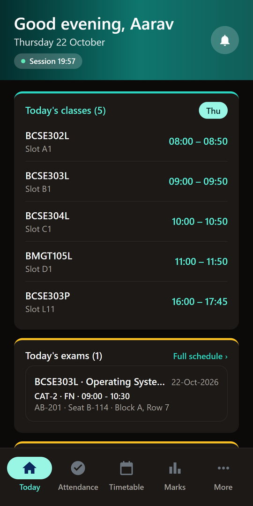
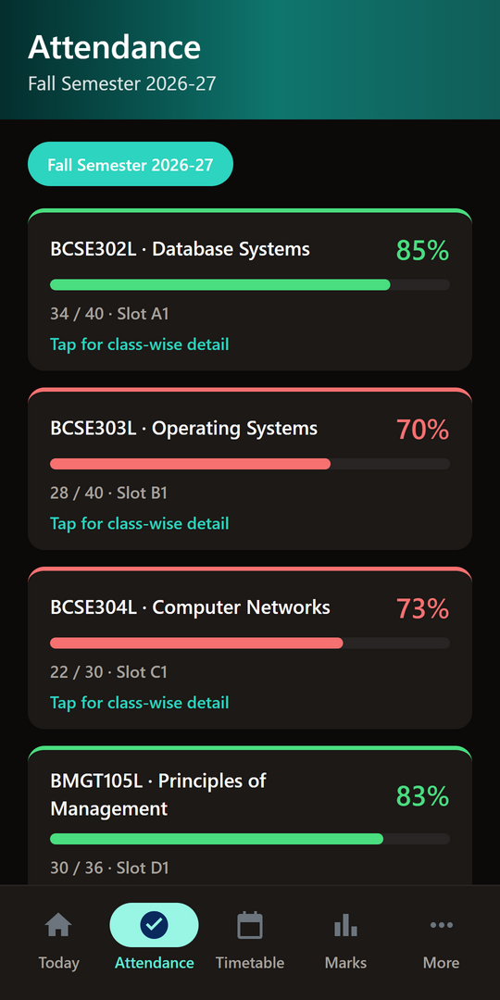
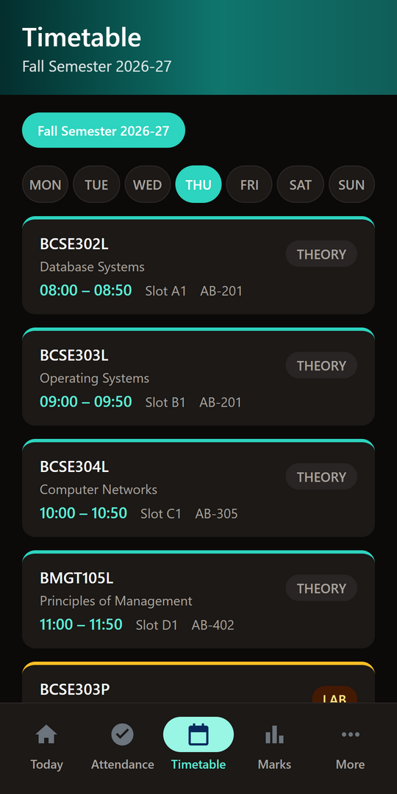
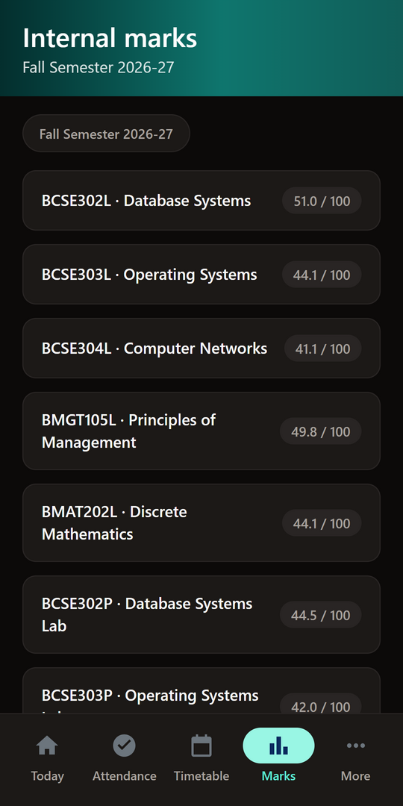
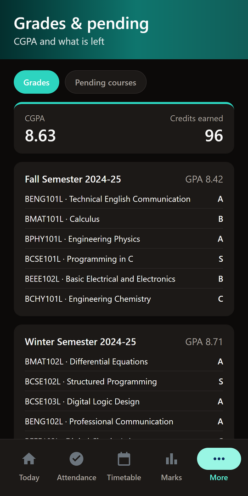
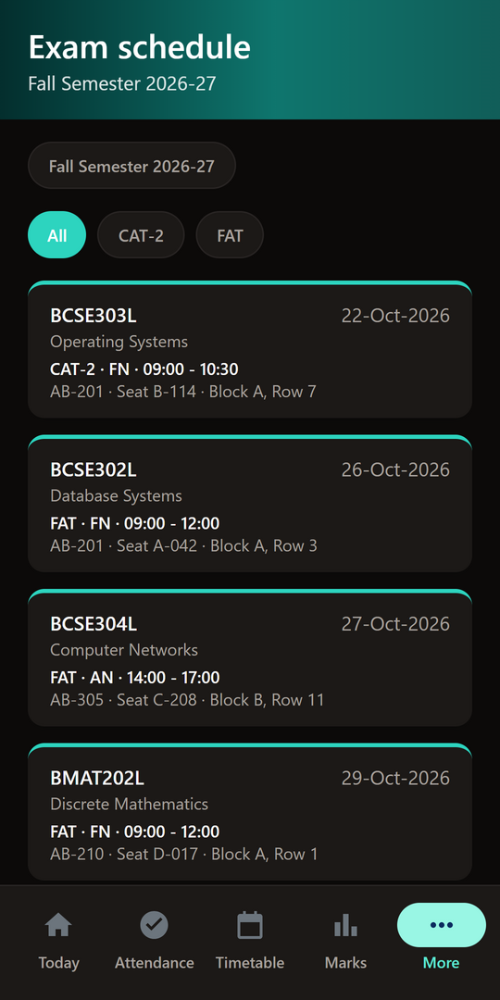
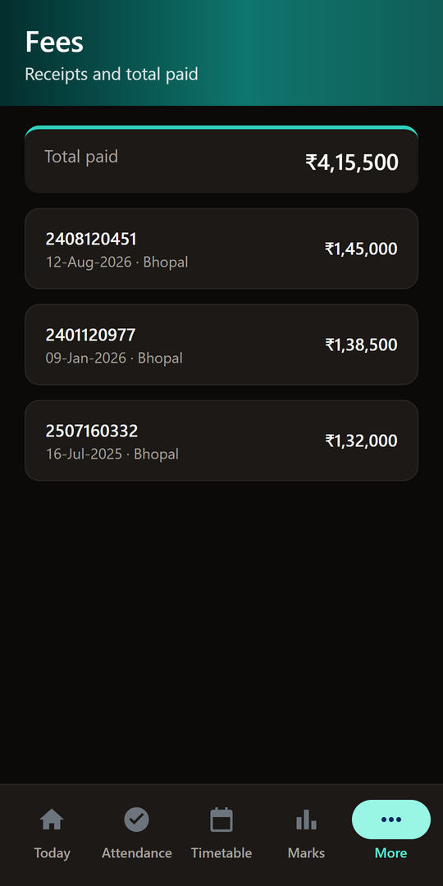
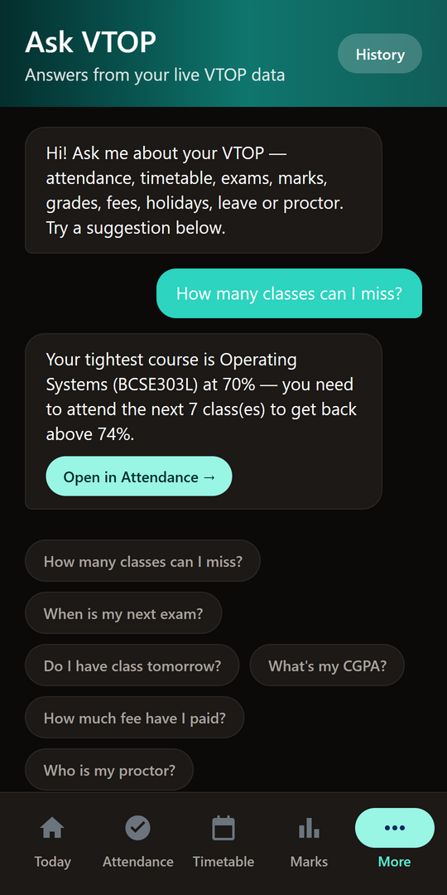

# V Bhopal — downloads & issue tracker

An unofficial Android client for VIT Bhopal's VTOP portal — attendance, timetable, marks, exams, calendar, fees, hostel leave, and profile in a clean native-feeling app.

> **Unofficial.** V Bhopal is an independent third-party client. It is not made, endorsed, or supported by VIT Bhopal, and it is not affiliated with them in any way. You are responsible for complying with VIT Bhopal's terms of use.

## Download

**[Get it on Google Play](https://play.google.com/store/apps/details?id=ac.cipherxhub.vbhopal)** — Google Play installs updates for you. This is the version most people want.

Prefer a plain APK? Grab the latest from
[**Releases**](https://github.com/CipherxHub/vtop-bhopal-updates/releases). That build
notifies you in-app when a new version is out and can download + install it directly
(Android always asks you to confirm the install).

> Allowed: install and use the app on your own device.
> Not allowed: copying, modifying, redistributing, or re-uploading the APK or any part of the app. The source code is proprietary and is not published here.

## Screens

| Today | Attendance | Timetable | Marks |
|---|---|---|---|
|  |  |  |  |

| Grades | Exams | Fees | Ask VTOP |
|---|---|---|---|
|  |  |  |  |

These are the app's built-in demo account (`99DEM0000`) — no real student's
record is shown anywhere on this page.

## Two channels, one app

The Play build and the APK are the same app from the same source, but Android treats
them as different apps: they have separate package ids and cannot update one another.
Pick one and stay with it — switching means uninstalling first. Use the Play build if
you have Play; use the APK on a phone without it.

## Report an issue

Open an issue with:

- App version (More → Check for updates shows it)
- Android version + device model
- What you did, what you expected, what happened instead
- Screenshots (please hide your registration number / personal details)

## Privacy

Full detail is in the [privacy policy](PRIVACY.md).

Your VTOP credentials go only to `vtop.vitbhopal.ac.in` over your device's own connection. They are **never** sent to us, and we have no account for you and no server-side store of your VTOP data — no attendance, marks, profile or credentials.

What does stay on your device: if you turn on biometric unlock, your password is kept in an Android encrypted vault (AES-256, key in the Android keystore) on that phone only. Attendance, marks, timetable, profile and your Ask VTOP chats are cached locally so the app opens instantly. Cached VTOP records are wiped when you log out or tap **Forget saved login**; chats are deleted from the Ask screen's History view; uninstalling removes everything.

The only thing that reaches a server of ours is the install count (v2.0+): one anonymous ping per day carrying a random install ID and the app version — no identity, no usage data. Turn it off anytime in More → Anonymous usage stats.

The app also asks GitHub's public API whether a newer release exists. That request carries nothing about your VTOP account; GitHub sees it like any other web request. Nothing is sent before you accept the first-launch agreement.
